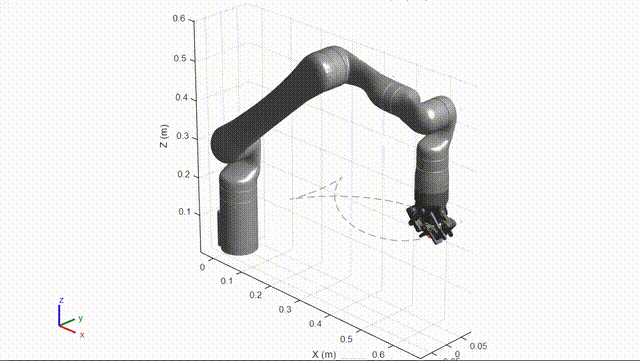
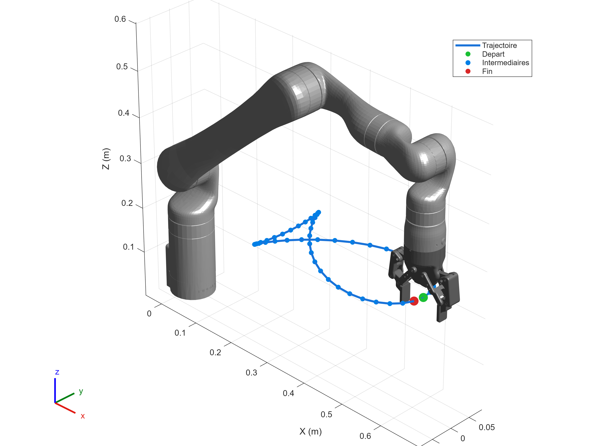
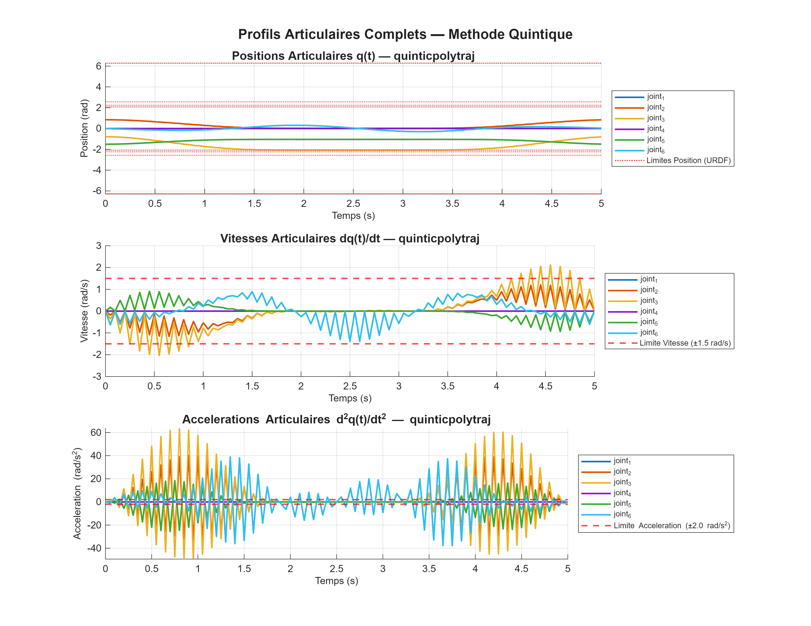
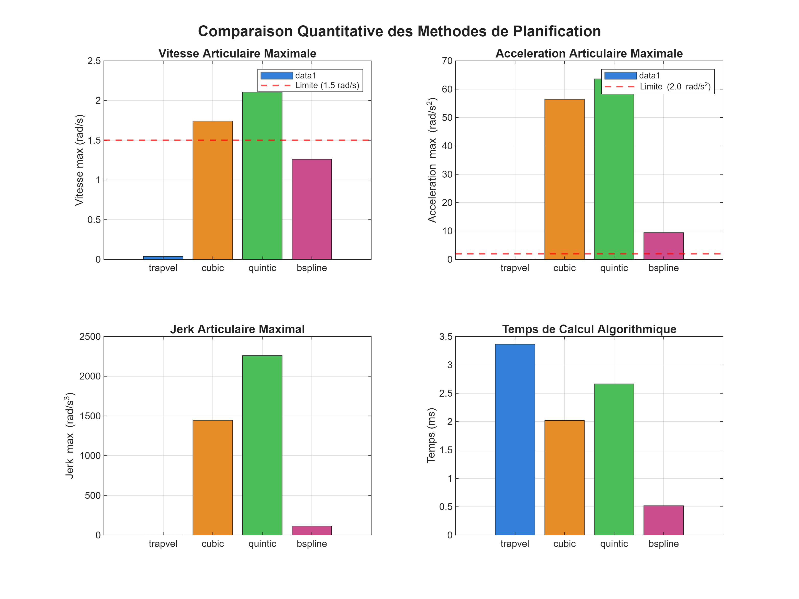

#  KinovaCraft — Trajectory Planning & Co-Simulation for Kinova Gen3 6-DOF (MATLAB & ROS 2)


Comprehensive project for parametric shape generation, safe inverse kinematics resolution, benchmark of 4 joint-space interpolation methods, and real-time co-simulation between **MATLAB** and **ROS 2 / RViz2** for the **Kinova Gen3 6-DOF** manipulator equipped with the **Robotiq 2F-85** gripper.

---

##  Preview & Visual Results

### 1. Kinova Gen3 Animated Simulation (Trajectory at Tool Center Point)
The Robotiq gripper closes at the very first point, firmly holds the tool throughout the entire trajectory tracing, and the continuous orange path is drawn directly from the tip of the closed fingers (TCP).

<p align="center">
  
</p>

---

### 2. 3D Parametric Shape & Target Waypoints
3D visualization showing the manipulator initial pose, the closed trajectory path, and the distribution of waypoints validated through inverse kinematics ($< 10^{-3}\text{ m}$).

<p align="center">
  
</p>

---

### 3. Complete Joint Profiles — Quintic Polynomial Method
Time evolution of joint positions $q_i(t)$, velocities $\dot{q}_i(t)$, and accelerations $\ddot{q}_i(t)$ for the 6 joints with physical limit boundaries indicated by red dashed lines.

<p align="center">
  
</p>

---

### 4. Benchmark Comparison of the 4 Methods
Quantitative comparison across 4 key metrics: **Maximum Velocity**, **Maximum Acceleration**, **Maximum Jerk** (smoothness/chatter), and **Algorithmic Computation Time**.

<p align="center">
  
</p>

#### Summary Metrics Table (`metrics_comparison.csv`):
| Interpolation Method | Total Duration ($s$) | Computation Time ($ms$) | Max Velocity ($\text{rad/s}$) | Max Acceleration ($\text{rad/s}^2$) | Max Jerk ($\text{rad/s}^3$) | IK Failures | Limits OK |
| :--- | :---: | :---: | :---: | :---: | :---: | :---: | :---: |
| **`trapveltraj`** (Trapezoidal) | 5.0 | 3.37 | 0.037 | 0.022 | 0.85 | 0 | **YES** ✅ |
| **`cubicpolytraj`** (Cubic $C^1$) | 5.0 | 2.02 | 1.742 | 56.46 | 1446.12 | 0 | NO ⚠️ |
| **`quinticpolytraj`** (Quintic $C^2$) | 5.0 | 2.67 | 2.107 | 63.62 | 2260.62 | 0 | NO ⚠️ |
| **`bsplinepolytraj`** (B-spline $C^2$) | 5.0 | 0.52 | 1.261 | 9.42 | 115.81 | 0 | NO ⚠️ |

> *Note: Limit violations over a short duration ($5\,\text{s}$) can be easily resolved by increasing the total trajectory duration (`p.traj.total_time = 20.0`) in `params.m` to achieve smooth and 100% compliant motion.*

---

##  Key Features

- **Official Kinova Gen3 6-DOF Model**: Loaded via `importrobot('gen3_6dof.urdf')` (strictly 6 active controlled joints, enforced by `assert(numel(q) == 6)`).
- **Tool Center Point (TCP)**: Continuous trail drawn directly at the **tip of the gripper fingers** (`tcp_link`, Z = +12 cm from the wrist flange).
- **Active Robotiq 2F-85 Gripper Control**: Automatic closing at the first point when starting the shape, holding during trajectory tracing, and automatic opening at the final point.
- **Cartesian Parametric Shapes**:
  - `rose` (Rhodonea rose curve with configurable `n_petals`, adapted period to prevent redundant loops).
  - `fish` (Parametric fish curve).
  - `square` (Closed square path).
- **Robust Inverse Kinematics (IK)**: Encapsulated in `try-catch` blocks, singularity rejection, and strict error tolerance ($< 10^{-3}\text{ m}$).
- **Benchmark of 4 Interpolation Methods**:
  1. Trapezoidal velocity profile (`trapveltraj`)
  2. Cubic piecewise polynomial $C^1$ (`cubicpolytraj`)
  3. Quintic piecewise polynomial $C^2$ (`quinticpolytraj`)
  4. Uniform B-spline $C^2$ (`bsplinepolytraj`)
- **Automated Performance Metrics**: Duration, computation time, $\dot{q}_{\max}$, $\ddot{q}_{\max}$, maximum jerk ($\text{rad/s}^3$), IK failures, physical limits compliance boolean, and CSV export.
- **Wireless ROS 2 / RViz2 Co-Simulation**: Real-time DDS streaming (`/joint_states` and `/trajectory_path`) to RViz2 running on a host machine or VM.
- **Zero Hard-Coded Values**: Every parameter is loaded exclusively from `params.m`.

---

##  Repository Structure

```
KinovaCraft/
├── README.md                          # Main project documentation with visual results
├── .gitignore                         # Ignored files (ROS 2 build artifacts, MATLAB temp files)
├── kinova_trajectory_matlab/           # Main MATLAB project
│   ├── main.m                         # Main entry point pipeline
│   ├── params.m                       # Central configuration file (zero hard-coded values)
│   ├── setup_urdf.sh                  # Automated URDF / mesh setup script
│   ├── README.md                      # Inner MATLAB package documentation
│   ├── src/
│   │   ├── load_robot_model.m         # Import URDF, dynamic EE (TCP) extraction & limits
│   │   ├── generate_shape.m           # Cartesian shape generator (rose, fish, square)
│   │   ├── solve_ik_for_shape.m       # Safe IK solver with try-catch
│   │   ├── plan_trajectories.m        # Core engine for the 4 trajectory methods
│   │   ├── evaluate_metrics.m         # Metrics evaluation, console table & CSV export
│   │   ├── plot_shape_3d.m            # 3D plot of shape and waypoints
│   │   ├── plot_joint_profiles.m      # q, q̇, q̈ joint profiles with red limit lines
│   │   ├── plot_comparison_bar.m      # Multi-criteria comparative bar chart
│   │   ├── animate_robot.m            # Fast MP4 video renderer with active gripper
│   │   ├── publish_ros2_trajectory.m  # Synchronized streaming ROS 2 publisher node
│   │   └── urdf/                      # Adapted 6-DOF URDF and 3D meshes
│   │       ├── gen3_6dof.urdf
│   │       └── meshes/
│   │           ├── arm/               # Official Gen3 6-DOF arm STL files
│   │           └── gripper/           # Robotiq 2F-85 gripper DAE/STL files
│   └── results/                       # Automatically generated results
│       ├── forme_3d.png
│       ├── profils_articulaires.png
│       ├── comparaison_methodes.png
│       ├── metrics_comparison.csv
│       ├── trajectoire.mp4
│       └── trajectoire_preview.gif
│
└── src/
    ├── ros2_kortex/                   # Official Kinova ROS 2 definitions (kortex_description)
    └── trajectory_planner_g6/         # ROS 2 bridge package for RViz2
        ├── launch/
        │   └── matlab_rviz.launch.py  # Launches robot_state_publisher + RViz2
        ├── rviz/
        │   └── trajectory_viz.rviz    # RViz2 configuration (RobotModel + orange Path)
        ├── scripts/
        │   └── record_rviz.sh         # RViz2 video recording script
        ├── package.xml
        └── setup.py
```

---

##  Prerequisites

### MATLAB Side (Host Machine Windows / Mac / Linux)
- **MATLAB R2021a** or later
- **Robotics System Toolbox** (required)
- **ROS Toolbox** (required for live streaming connection to RViz2)

### ROS 2 Side (Linux Ubuntu 22.04 / VM)
- **ROS 2 Humble**
- ROS 2 packages:
  ```bash
  sudo apt update
  sudo apt install -y ros-humble-robot-state-publisher ros-humble-rviz2 ros-humble-xacro
  ```

---

##  Step-by-Step Execution Guide

### 1. URDF Setup (Run once, on Linux)
```bash
cd ~/KinovaCraft/kinova_trajectory_matlab
./setup_urdf.sh
```
This script copies the STL/DAE meshes, configures the TCP frame at the fingertip, and ensures exactly 6 active DOF for MATLAB.

### 2. Launch the RViz2 Visualizer (in Linux terminal)
```bash
cd ~/KinovaCraft
source /opt/ros/humble/setup.bash
colcon build --packages-select trajectory_planner_g6 --symlink-install
source install/setup.bash

export ROS_DOMAIN_ID= <your_VMware_ID>
ros2 launch trajectory_planner_g6 matlab_rviz.launch.py
```
> The Kinova Gen3 6-DOF appears in RViz2 in passive mode, waiting for MATLAB trajectory commands.

### 3. Run Simulation in MATLAB
1. Open MATLAB on your machine.
2. Set the current folder:
   ```matlab
   cd('path/to/KinovaCraft/kinova_trajectory_matlab')
   ```
3. Check parameters in `params.m`:
   ```matlab
   p.shape.type     = 'rose';          % 'rose', 'fish', or 'square'
   p.ros2.enable    = true;            % Enable co-simulation
   p.ros2.domain_id = 30;              % Match your Linux VM Domain ID
   ```
4. Run the main script:
   ```matlab
   main
   ```

---

##  References & Sources

- **Kinova Robotics**: [ros2_kortex (GitHub)](https://github.com/Kinovarobotics/ros2_kortex) for the official Gen3 6-DOF URDF model.
- **MathWorks Robotics System Toolbox**:
  - `importrobot`: Rigid body tree model import.
  - `inverseKinematics`: Numerical IK solver with weighting constraints.
  - `trapveltraj`, `cubicpolytraj`, `quinticpolytraj`, `bsplinepolytraj`: Joint trajectory generation tools.

---

## 👤 Author

**Aziz IGUIDRE** — Future Engineer in Mechatronic at ENSA FES 

