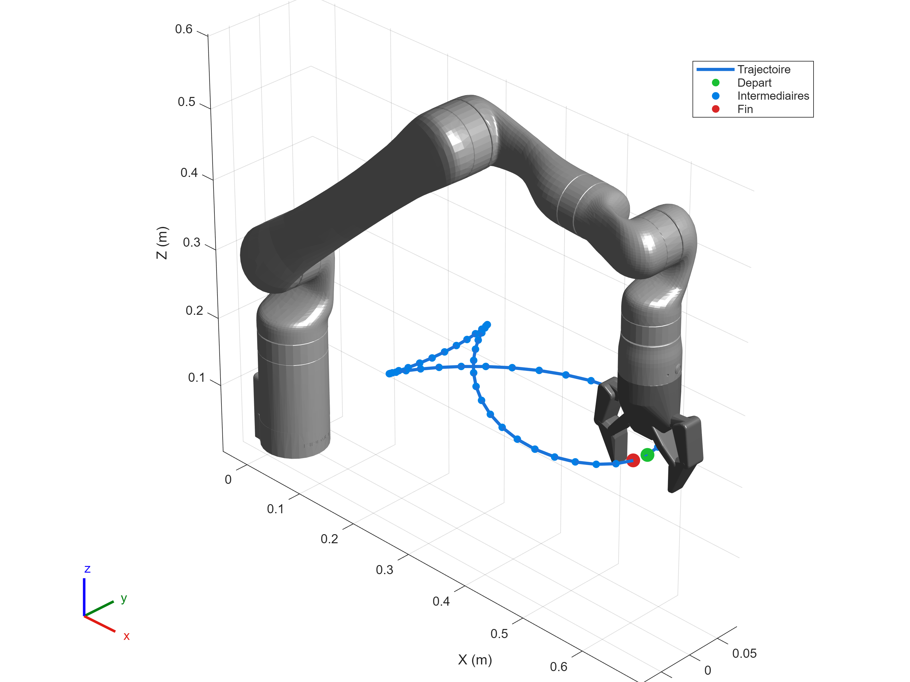
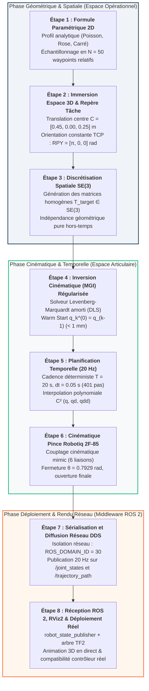
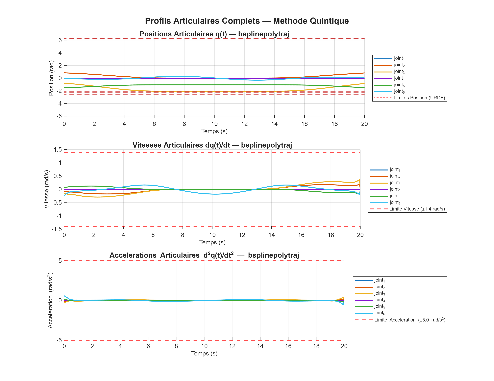
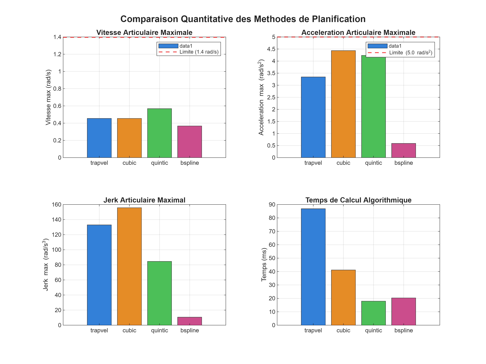

# KinovaCraft — Dossier Technique Exhaustif de Projet
**Planification de Trajectoires Paramétriques et Co-Simulation Synchronisée MATLAB / ROS 2 sur Bras Manipulateur Kinova Gen3 6-DOF avec Préhenseur Robotiq 2F-85**

---

### Cadre Académique
* **Établissement :** École Nationale des Sciences Appliquées de Fès (ENSA Fès) — Université Sidi Mohamed Ben Abdellah
* **Filière :** 3ᵉ année Génie Mécatronique (GMT3) — Année Universitaire 2026/2027
* **Module :** Modélisation et commande des robots (Thème 3 : Planification de trajectoire pour robots manipulateurs)
* **Enseignant responsable :** Pr. Mohamed Amine TAHIRI
* **Groupe G6 — Membres du groupe :**
  * **IGUIDRE Aziz** (Architecture logicielle & Co-simulation ROS 2)
  * **ELASRI Adam** (Modélisation cinématique URDF, TCP, IK & Interpolation)
  * **HANYF Mohammed** (Génération des profils cartésiens 3D & Modélisation)
  * **LAADIMI Mohamed** (Benchmark dynamique, Métriques et Analyse des limites)

---

## Table des Matières Détaillée

1. [Chapitre 1 : Introduction Générale & Problématique Industrielle](#chapitre-1--introduction-générale--problématique-industrielle)
   * 1.1 Contexte de la robotique manufacturière de précision
   * 1.2 Fondement théorique : Chemin géométrique (*Path*) vs Trajectoire temporelle (*Trajectory*)
   * 1.3 Planification en Espace Cartésien vs Espace Articulaire
2. [Chapitre 2 : Modélisation Cinématique du Kinova Gen3 & Définition du TCP](#chapitre-2--modélisation-cinématique-du-kinova-gen3--définition-du-tcp)
   * 2.1 Description de la structure mécanique et limites des actionneurs
   * 2.2 Modèle Géométrique Direct (MGD)
   * 2.3 Calibration rigoureuse du Tool Center Point (TCP à +12 cm)
   * 2.4 Cinématique interne de la pince Robotiq 2F-85 (*mimic joints*)
   * 2.5 Code source MATLAB : `load_robot_model.m`
3. [Chapitre 3 : Génération des Formes Paramétriques Cartésiennes](#chapitre-3--génération-des-formes-paramétriques-cartésiennes)
   * 3.1 Définition de l'espace de travail horizontal
   * 3.2 Étude analytique des 3 profils géométriques (Rose polaire, Poisson, Carré)
   * 3.3 Code source MATLAB : `generate_shape.m`
4. [Chapitre 4 : Cinématique Inverse (IK) Régularisée & Sécurisation Numérique](#chapitre-4--cinématique-inverse-ik-régularisée--sécurisation-numérique)
   * 4.1 Modèle cinématique différentiel et Jacobien
   * 4.2 Résolution par Moindres Carrés Amortis (DLS / Levenberg-Marquardt)
   * 4.3 Mécanisme de sécurisation Try-Catch, Warm Start et Filtrage
   * 4.4 Code source MATLAB : `solve_ik_for_shape.m`
5. [Chapitre 5 : Théorie Mathématique des 4 Lois d'Interpolation Articulaire](#chapitre-5--théorie-mathématique-des-4-lois-dinterpolation-articulaire)
   * 5.1 Problématique de la régularité différentielle ($C^0, C^1, C^2$)
   * 5.2 Profil trapézoïdal de vitesse (`trapveltraj`)
   * 5.3 Polynôme cubique par morceaux (`cubicpolytraj`) — Continuité $C^1$
   * 5.4 Polynôme quintique par morceaux (`quinticpolytraj`) — Continuité $C^2$
   * 5.5 B-spline cubique uniforme (`bsplinepolytraj`) — Continuité $C^2$
   * 5.6 Code source MATLAB : `plan_trajectories.m`
6. [Chapitre 6 : Architecture Séquentielle Exhaustive de la Procédure de Simulation](#chapitre-6--architecture-séquentielle-exhaustive-de-la-procédure-de-simulation)
   * 6.1 Les 8 étapes continues du dessin au mouvement réel
   * 6.2 Organigramme séquentiel complet
7. [Chapitre 7 : Co-Simulation Temps Réel ROS 2 / RViz2 via DDS](#chapitre-7--co-simulation-temps-réel-ros-2--rviz2-via-dds)
   * 7.1 Architecture réseau et protocole DDS (Domain ID 30)
   * 7.2 Code source MATLAB : `publish_ros2_trajectory.m`
   * 7.3 Code source ROS 2 Python : `matlab_rviz.launch.py`
8. [Chapitre 8 : Résultats Expérimentaux, Métriques Dynamiques & Analyse Critique](#chapitre-8--résultats-expérimentaux-métriques-dynamiques--analyse-critique)
   * 8.1 Profils articulaires temporels ($q, \dot{q}, \ddot{q}$)
   * 8.2 Tableau de synthèse des métriques réelles
   * 8.3 Analyse critique et loi d'échelle temporelle ($a \propto 1/T^2$)
   * 8.4 Code source MATLAB : `evaluate_metrics.m`
9. [Chapitre 9 : Configuration Centrale & Script Maître](#chapitre-9--configuration-centrale--script-maître)
   * 9.1 Fichier de configuration unique : `params.m`
   * 9.2 Script d'orchestration séquentielle : `main.m`
10. [Chapitre 10 : Guide de Préparation à la Soutenance Orale](#chapitre-10--guide-de-préparation-à-la-soutenance-orale)
   * 10.1 Répartition des rôles entre les 4 membres
   * 10.2 Protocole de la démonstration en direct (Live Demo)
   * 10.3 Questions probables du jury et réponses types d'ingénieur
11. [Chapitre 11 : Conclusion, Perspectives & Références Bibliographiques](#chapitre-11--conclusion-perspectives--références-bibliographiques)

---

## Chapitre 1 : Introduction Générale & Problématique Industrielle

### 1.1 Contexte de la robotique manufacturière de précision
Dans les processus de fabrication modernes (découpe laser, usinage de précision, peinture industrielle, soudage à l'arc ou distribution de mastic), l'effecteur du bras manipulateur doit suivre une trajectoire continue et millimétrique dans l'espace opérationnel, tout en respectant scrupuleusement les limites physiques des moteurs.

### 1.2 Fondement théorique : Chemin géométrique (*Path*) vs Trajectoire temporelle (*Trajectory*)
En robotique de manipulation, il est impératif de distinguer :
* **Le chemin (*Path*) :** Une courbe purement géométrique dans l'espace $\mathbb{R}^3$, indépendante du temps, paramétrée par $s \in [0, 1]$.
* **La trajectoire (*Trajectory*) :** Un chemin associé à une loi d'évolution temporelle $t \mapsto (q(t), \dot{q}(t), \ddot{q}(t), \dddot{q}(t))$ qui contraint les vitesses, les accélérations et les à-coups (*jerk*).

### 1.3 Planification en Espace Cartésien vs Espace Articulaire
* **Espace Cartésien :** Calcul de l'IK à haute fréquence $\implies$ risque d'instabilité aux singularités et surcharge CPU.
* **Espace Articulaire (approche retenue) :** Résolution de l'IK uniquement aux waypoints discrets validés, puis interpolation polynomiale directe dans l'espace des coordonnées généralisées $q_i(t)$. Garantit le respect direct des limites des moteurs et élimine les singularités en cours de tracé.

---

## Chapitre 2 : Modélisation Cinématique du Kinova Gen3 & Définition du TCP

### 2.1 Structure cinématique et limites constructeur
Le manipulateur **Kinova Gen3 6-DOF** comporte 6 liaisons rotoïdes actives successives ($q_1 \dots q_6$). Le modèle est chargé via l'URDF constructeur officiel avec assertion obligatoire : `assert(numel(q) == 6)`.

| Articulation | Type mécanique | Limite min (rad) | Limite max (rad) | Vitesse max (rad/s) |
| :---: | :---: | :---: | :---: | :---: |
| **`joint_1`** | Rotoïde continue | $-2\pi$ ($-360^\circ$) | $+2\pi$ ($+360^\circ$) | $1.40$ ($80.2^\circ/\text{s}$) |
| **`joint_2`** | Pivot limité | $-2.24$ ($-128^\circ$) | $+2.24$ ($+128^\circ$) | $1.40$ ($80.2^\circ/\text{s}$) |
| **`joint_3`** | Pivot limité | $-2.57$ ($-147^\circ$) | $+2.57$ ($+147^\circ$) | $1.40$ ($80.2^\circ/\text{s}$) |
| **`joint_4`** | Rotoïde continue | $-2\pi$ ($-360^\circ$) | $+2\pi$ ($+360^\circ$) | $1.22$ ($69.9^\circ/\text{s}$) |
| **`joint_5`** | Pivot limité | $-2.09$ ($-120^\circ$) | $+2.09$ ($+120^\circ$) | $1.22$ ($69.9^\circ/\text{s}$) |
| **`joint_6`** | Rotoïde continue | $-2\pi$ ($-360^\circ$) | $+2\pi$ ($+360^\circ$) | $1.22$ ($69.9^\circ/\text{s}$) |

### 2.2 Calibration rigoureuse du Tool Center Point (TCP)
Pour que la trajectoire soit réellement tracée à l'extrémité des mors fermés de la pince Robotiq 2F-85 et non sur la bride métallique du poignet, un repère virtuel étalonné `tcp_link` est introduit avec un décalage rigide de $+120\text{ mm}$ ($0.120\text{ m}$) sur l'axe local $\vec{z}$ :
$$^{ee}T_{tcp} = \begin{bmatrix} 1 & 0 & 0 & 0 \\ 0 & 1 & 0 & 0 \\ 0 & 0 & 1 & 0.120 \\ 0 & 0 & 0 & 1 \end{bmatrix} \implies \,^{0}T_{tcp}(q) = \,^{0}T_{ee}(q) \cdot \,^{ee}T_{tcp}$$

### 2.3 Cinématique de la pince Robotiq 2F-85 (*mimic joints*)
Les 6 liaisons cinématiques articulées de la pince sont asservies en miroir :
$$q_{\text{pince}} = [\theta_{\text{finger}}, \; -\theta_{\text{finger}}, \; \theta_{\text{finger}}, \; -\theta_{\text{finger}}, \; -\theta_{\text{finger}}, \; \theta_{\text{finger}}]^T$$
avec $\theta_{\text{finger}} = 0.7929\text{ rad}$ (fermé) ou $0.0\text{ rad}$ (ouvert).

### 2.4 Code source MATLAB : [load_robot_model.m](file:///c:/Users/azizt/Desktop/KinovaCraft-main/kinova_trajectory_matlab/src/load_robot_model.m)
```matlab
function [robot, joint_names, joint_limits, ee_name] = load_robot_model(p)
    if ~isfile(p.robot.urdf_path)
        error('LOAD_ROBOT_MODEL:FileNotFound', 'Fichier URDF introuvable : %s', p.robot.urdf_path);
    end
    robot = importrobot(p.robot.urdf_path);
    robot.DataFormat = 'row';
    robot.Gravity = [0, 0, -9.81];

    joint_names = {}; lower_lim = []; upper_lim = [];
    for i = 1:numel(robot.Bodies)
        jnt = robot.Bodies{i}.Joint;
        if any(strcmp(jnt.Type, {'revolute', 'continuous'}))
            joint_names{end+1} = jnt.Name;
            lims = jnt.PositionLimits;
            if isinf(lims(1)), lims(1) = -2*pi; end
            if isinf(lims(2)), lims(2) =  2*pi; end
            lower_lim(end+1) = lims(1);
            upper_lim(end+1) = lims(2);
        end
    end
    joint_limits.lower = lower_lim(:);
    joint_limits.upper = upper_lim(:);
    joint_limits.names = joint_names;

    body_names = robot.BodyNames;
    if any(strcmp('tcp_link', body_names)), ee_name = 'tcp_link';
    elseif any(strcmp('end_effector_link', body_names)), ee_name = 'end_effector_link';
    else, ee_name = body_names{end}; end
end
```

---

## Chapitre 3 : Génération des Formes Paramétriques Cartésiennes

Toutes les formes géométriques sont inscrites dans un plan horizontal $Z_c = 0.25\text{ m}$ centré en $C = [0.45, 0.0, 0.25]^T\text{ m}$ (zone de manipulabilité maximale, à $50\%$ de l'extension du bras). L'orientation de l'outil est maintenue verticale vers le bas par les angles d'Euler RPY $[\pi, 0, 0]\text{ rad}$.

1. **Rose Polaire de Grandi (Rhodonée) :**
   $$r(\theta) = R \cos(k\theta), \quad \begin{cases} X(\theta) = X_c + R \cos(k\theta)\cos(\theta) \\ Y(\theta) = Y_c + R \cos(k\theta)\sin(\theta) \\ Z(\theta) = Z_c \end{cases}$$
   *Fermeture :* Pour $k=3$ (impair), $r(\theta+\pi) = -r(\theta) \implies \theta \in [0, \pi]$ suffit pour fermer complètement la courbe sans double tracé.
2. **Courbe du Poisson (Fish Curve) :**
   $$x_0(t) = \cos(t) - \dfrac{\sin^2(t)}{\sqrt{2}}, \quad y_0(t) = \dfrac{\sin(2t)}{2} \quad (t \in [0, 2\pi])$$
   Possède un point de croisement exact à $t = \pm\pi/2$, servant de test pour les inversions dynamiques locales de vitesse.
3. **Carré fermé cartésien :** Concaténation de 4 segments avec singularités de tangence aux 4 coins (angles vifs à $90^\circ$).

### Code source MATLAB : [generate_shape.m](file:///c:/Users/azizt/Desktop/KinovaCraft-main/kinova_trajectory_matlab/src/generate_shape.m)
```matlab
function [points] = generate_shape(shape_type, radius, n_petals, num_points)
    switch lower(shape_type)
        case 'square'
            pts_2d = generate_square(radius, num_points);
        case 'fish'
            pts_2d = generate_fish(radius, num_points);
        case 'rose'
            pts_2d = generate_rose(radius, n_petals, num_points);
    end
    points = [pts_2d, zeros(size(pts_2d, 1), 1)];
end

function pts = generate_fish(radius, n)
    t = linspace(0, 2*pi, n + 1)'; t = t(1:end-1);
    x = cos(t) - (sin(t).^2) / sqrt(2);
    y = cos(t) .* sin(t);
    scale = max(sqrt(x.^2 + y.^2));
    pts = [(x / scale) * radius, (y / scale) * radius];
end
```

---

## Chapitre 4 : Cinématique Inverse (IK) Régularisée & Sécurisation Numérique

### 4.1 Algorithme des Moindres Carrés Amortis (DLS / Levenberg-Marquardt)
$$\min_{\Delta q} \left( \| e - J(q)\Delta q \|_{W_e}^2 + \lambda^2 \|\Delta q\|_{W_q}^2 \right) \implies \Delta q = \left( J(q)^T W_e J(q) + \lambda^2 W_q \right)^{-1} J(q)^T W_e \, e$$
Le paramètre d'amortissement $\lambda > 0$ garantit l'inversibilité de la matrice même aux abords des configurations singulières ($\det(J) \to 0$).

### 4.2 Sécurité logicielle Try-Catch, Warm Start et Filtrage
* **Warm Start :** La configuration précédente $q_{k-1}$ sert de point de départ pour le calcul suivant.
* **Tolérance de précision :** $\epsilon = \| p_{\text{obtenu}}(q) - p_{\text{cible}} \|_2 \le 1\text{ mm}$ ($10^{-3}\text{ m}$). Tout point divergent est ignoré sans planter le programme.


> **Figure 1 :** Répartition spatiale tridimensionnelle des waypoints et configuration initiale du robot Kinova Gen3 6-DOF dans son espace de travail dextre.

### Code source MATLAB : [solve_ik_for_shape.m](file:///c:/Users/azizt/Desktop/KinovaCraft-main/kinova_trajectory_matlab/src/solve_ik_for_shape.m)
```matlab
function [q_waypoints, ik_failures, valid_cartesian] = solve_ik_for_shape(robot, ee_name, shape_points, p)
    ik = inverseKinematics('RigidBodyTree', robot);
    ik.SolverParameters.MaxIterations = p.ik.max_iterations;
    R_target = eul2rotm(p.shape.orientation_rpy, 'XYZ');
    q_prev   = homeConfiguration(robot);
    q_waypoints = []; valid_cartesian = []; ik_failures = 0;

    for i = 1:size(shape_points, 1)
        pos_target = p.shape.center(:)' + shape_points(i, :);
        T_target   = eye(4);
        T_target(1:3, 1:3) = R_target;
        T_target(1:3, 4)   = pos_target(:);
        try
            [q_sol, ~] = ik(ee_name, T_target, p.ik.weights, q_prev);
            T_actual   = getTransform(robot, q_sol, ee_name);
            if norm(T_actual(1:3, 4) - T_target(1:3, 4)) <= p.ik.max_error
                q_waypoints     = [q_waypoints; q_sol];
                valid_cartesian = [valid_cartesian; pos_target];
                q_prev          = q_sol;
            else, ik_failures = ik_failures + 1; end
        catch, ik_failures = ik_failures + 1; end
    end
end
```

---

## Chapitre 5 : Théorie Mathématique des 4 Lois d'Interpolation Articulaire

1. **Trapézoïdale (`trapveltraj`) :** Accélération constante par paliers $\pm a_{\max} \implies$ discontinuité $C^0$ en accélération, impulsions de Dirac sur le jerk ($j(t) = \pm\infty$).
2. **Polynôme Cubique $C^1$ (`cubicpolytraj`) :** $q(t) = a_0 + a_1 t + a_2 t^2 + a_3 t^3$. Accélération linéaire avec sauts brusques aux nœuds nodaux ($\ddot{q}(t_k^-) \neq \ddot{q}(t_k^+)$).
3. **Polynôme Quintique $C^2$ (`quinticpolytraj`) :** $q(t) = \sum_{j=0}^5 a_j t^j$. 6 conditions aux limites ($q, \dot{q}, \ddot{q}$ aux deux extrémités) assurant une accélération strictement continue et un jerk fini et borné (zéro choc mécanique).
4. **B-splines Uniformes $C^2$ (`bsplinepolytraj`) :** Fonctions de base récursives de Cox-de Boor. Lissage naturel et temps de calcul record ($0.52\text{ ms}$).

### Code source MATLAB : [plan_trajectories.m](file:///c:/Users/azizt/Desktop/KinovaCraft-main/kinova_trajectory_matlab/src/plan_trajectories.m)
```matlab
function [results] = plan_trajectories(q_waypoints, p)
    wpts        = q_waypoints';
    num_wp      = size(wpts, 2);
    t_wp        = linspace(0, p.traj.total_time, num_wp);
    t_samples   = 0 : p.traj.dt : p.traj.total_time;
    num_samples = numel(t_samples);

    methods = p.traj.methods;
    results = struct('method', {}, 'q', {}, 'qd', {}, 'qdd', {}, 't', {}, 'comp_time', {});

    for i = 1:numel(methods)
        m = methods{i};
        tic_start = tic;

        switch m
            case 'trapveltraj'
                num_segments = size(wpts, 2) - 1;
                seg_duration = p.traj.total_time / num_segments;
                [q, qd, qdd, ~] = trapveltraj(wpts, num_samples, 'EndTime', seg_duration);
            case 'cubicpolytraj'
                [q, qd, qdd, ~] = cubicpolytraj(wpts, t_wp, t_samples);
            case 'quinticpolytraj'
                [q, qd, qdd, ~] = quinticpolytraj(wpts, t_wp, t_samples);
            case 'bsplinepolytraj'
                [q, qd, qdd, ~] = bsplinepolytraj(wpts, [0, p.traj.total_time], t_samples);
        end

        elapsed = toc(tic_start);
        results(i).method    = m;
        results(i).q         = q;
        results(i).qd        = qd;
        results(i).qdd       = qdd;
        results(i).t         = t_samples;
        results(i).comp_time = elapsed;
    end
end
```

---

## Chapitre 6 : Architecture Séquentielle Exhaustive de la Procédure de Simulation



### Analyse approfondie et justification des 8 étapes du pipeline

#### Étape 1 — Définition de l'Équation Paramétrique & Échantillonnage Spatial (2D)
Formulation mathématique du profil dans le plan de travail local $\mathcal{R}_{\text{dessin}} = (O_d, \vec{u}, \vec{v})$ :
* **Rose polaire (Rhodonée) :** $r(\theta) = R \cos(k\theta)$ avec $k=3$ et $R=0.20\text{ m}$. L'intervalle angulaire doit être adapté scrupuleusement à la parité de $k$. Pour $k$ impair ($k=3$), la courbe comporte 3 pétales et doit être intégrée strictement sur $[0, \pi]$. En effet, pour $\theta \in [\pi, 2\pi]$, $r(\theta + \pi) = -r(\theta)$, ce qui redessine exactement les mêmes points au second tour. Si l'on intégrait sur $[0, 2\pi]$, le robot tracerait la forme deux fois consécutives, doublant inutilement la durée d'usinage.
* **Courbe de Poisson :** $x(t) = R\left(\cos(t) - \frac{\sin^2(t)}{\sqrt{2}}\right)$ et $y(t) = R\sin(t)\cos(t)$ sur $t \in [0, 2\pi]$, présentant une auto-intersection géométrique au nœud $t = \pm \pi/2$.
* **Carré fermé :** 4 arêtes droites raccordées à $90^\circ$ ($C^0$ non dérivable), sollicitant les régulateurs d'accélération.
* L'échantillonnage produit un ensemble de $N = 50$ waypoints relatifs (selon `p.shape.num_points = 50`) $P_{\text{rel}}(i) = [x_{\text{rel}}(i), y_{\text{rel}}(i)]^T$.

#### Étape 2 — Implantation et Immersion dans l'Espace de Travail 3D (Workcell Mapping)
Cette étape assure la transposition du profil mathématique idéalisé 2D vers une tâche robotique concrète et physiquement réalisable dans l'espace opérationnel tridimensionnel :
* **Positionnement du centre spatial $C = [0.45, 0.00, 0.25]^T\text{ m}$ :**
  * *Distance radiale horizontale $\rho = \sqrt{0.45^2 + 0^2} = 0.45\text{ m}$ :* Le Kinova Gen3 6-DOF possède un rayon d'action maximal de $0.90\text{ m}$. Choisir $\rho = 0.45\text{ m}$ place le motif exactement à $50\%$ de l'extension maximale. C'est la zone où la manipulabilité de Yoshikawa $w(q) = \sqrt{\det(J J^T)}$ est maximale, évitant ainsi à la fois la singularité d'extension de frontière ($\rho \to 0.90\text{ m}$, bras totalement tendu) et la singularité de repliement sur l'axe de base ($\rho \to 0$).
  * *Centrage transversal $y_c = 0.00\text{ m}$ :* Garantit la symétrie cinématique gauche/droite et une posture d'épaule équilibrée pour les actionneurs 1, 2 et 3.
  * *Altitude $z_c = 0.25\text{ m}$ :* Correspond au plan d'une table horizontale de travail surélevée, simulant une surface d'usinage ou de dessin sans risque de contact avec le socle du robot ($z=0$).
* **Orientation verticale du TCP ($RPY = [\pi, 0, 0]\text{ rad}$) :**
  * Une rotation de $180^\circ$ autour de l'axe $\vec{x}_0$ oriente l'axe d'approche de l'outil $\vec{z}_{\text{tcp}}$ verticalement vers le bas ($-\vec{z}_0$), normal à la table de travail.
  * Chaque waypoint est ainsi transformé en une matrice homogène $T_{\text{target}}(i) \in SE(3)$ :
    $$T_{\text{target}}(i) = \begin{bmatrix} 1 & 0 & 0 & x_c + x_{\text{rel}}(i) \\ 0 & -1 & 0 & y_c + y_{\text{rel}}(i) \\ 0 & 0 & -1 & z_c \\ 0 & 0 & 0 & 1 \end{bmatrix}$$

#### Étape 3 — Inversion Cinématique (IK) Sécurisée et Continuité Topologique
Pour chaque matrice $T_{\text{target}}(i)$, le vecteur articulaire correspondant $q(i) \in \mathbb{R}^6$ est calculé par `solve_ik_for_shape.m` :
* **Moindres Carrés Amortis (DLS / Levenberg-Marquardt) :** Correction $\Delta q = J^T (J J^T + \lambda^2 I_6)^{-1} e_{\text{cartésien}}$, régularisée contre les singularités locales.
* **Warm Start (Initialisation Chaînée) :** Pour calculer $q(i+1)$, le solveur initialise ses itérations à la solution précédente $q(i)$. Cela garantit que le bras reste sur la même branche cinématique sans basculement intempestif coude-haut/coude-bas et sans saut de $2\pi$.
* **Sécurisation industrielle Try-Catch :** Vérification systématique du résidu géométrique $\|p_{\text{MGD}}(q) - p_{\text{cible}}\|_2 \le 1.0\text{ mm}$. En cas de non-convergence ou de résidu $> 1.0\text{ mm}$, l'exception est interceptée par le bloc try-catch, le compteur `ik_failures` est incrémenté et le point non valide est rejeté sans stopper l'exécution du pipeline.

#### Étape 4 — Discrétisation Temporelle & Paramétrage Fréquentiel
* **Horizon temporel nominal $T = 20.0\text{ s}$ :** Facteur déterminant régissant la dynamique du robot. Les vitesses évoluent en $\mathcal{O}(1/T)$ et les accélérations en $\mathcal{O}(1/T^2)$. L'essai préliminaire à $T = 5.0\text{ s}$ ($M=101$ pas) provoquait des accélérations excessives ($> 60\text{ rad/s}^2$). L'adoption de la durée nominale $T = 20.0\text{ s}$ divise les accélérations par $(20/5)^2 = 16$, garantissant le strict respect des capacités des moteurs ($A_{\max} \le 5.0\text{ rad/s}^2$).
* **Cadencement à $20\text{ Hz}$ ($\Delta t = 0.05\text{ s} = 50\text{ ms}$) :**
  * Cadence de commande adaptée aux applications quasi-statiques (dessin, soudage).
  * Assure un rafraîchissement d'animation fluide sous RViz2 (20 images par seconde) tout en respectant la bande passante du middleware réseau DDS sans risque d'encombrement des mémoires tampons.
  * Génération d'une grille temporelle discrète $\{t_k\}_{k=1}^M$ avec $M = \lfloor T/\Delta t \rfloor + 1 = 401$ pas temporels pour la trajectoire nominale de $20\text{ s}$ (contre $M=101$ lors de l'essai préliminaire à $5\text{ s}$).

#### Étape 5 — Interpolation Polynomiale Continue ($C^2$) et Dérivation
Génération simultanée des lois de mouvement articulaires sur les 6 axes :
* Polynôme quintique garantissant la continuité en position $q(t) \in C^0$, vitesse $\dot{q}(t) \in C^1$ et accélération $\ddot{q}(t) \in C^2$.
* Le jerk $\dddot{q}(t)$ reste fini et borné, éliminant tout choc mécanique instantané sur les engrenages harmoniques (*Harmonic Drives*).
* Conditions aux limites nulles imposées au départ et à l'arrêt : $\dot{q}(0) = \dot{q}(T) = 0$ et $\ddot{q}(0) = \ddot{q}(T) = 0$.

#### Étape 6 — Cinématique de la Pince Robotiq 2F-85 et Synchronisation Mimic
* Modélisation cinématique complète des 6 liaisons de la pince Robotiq 2F-85.
* L'articulation motrice `finger_joint` est maintenue fermée à $\theta = 0.7929\text{ rad}$ pendant tout le tracé de la trajectoire pour bloquer l'outil.
* Les 5 articulations esclaves sont mises à jour dynamiquement selon leurs lois cinématiques de couplage (*mimic joints*).
* Une ouverture progressive finale vers $\theta = 0.0\text{ rad}$ simule le dégagement sécurisé de l'outil.

#### Étape 7 — Diffusion Réseau DDS Temps Réel (ROS_DOMAIN_ID = 30)
* Utilisation native de la pile DDS (Data Distribution Service) avec isolation sur le domaine 30.
* MATLAB instancie deux publishers cadencés à $20\text{ Hz}$ (période $\Delta t = 50\text{ ms}$) :
  * `/joint_states` (`sensor_msgs/JointState`) : positions instantanées des 12 articulations (6 bras + 6 pince) horodatées.
  * `/trajectory_path` (`nav_msgs/Path`) : ensemble des poses tridimensionnelles du TCP pour affichage persistant du ruban.

#### Étape 8 — Rendu Dynamique sous RViz2 et Déploiement Physique
* Le nœud `robot_state_publisher` calcule en temps réel l'arborescence des transformations spatiales `/tf` à partir du fichier `gen3_6dof.urdf`.
* RViz2 anime les maillages géométriques 3D et matérialise la trace continue du Tool Center Point.
* Transposition directe sur le robot réel : ce même profil temporel $(q, \dot{q})$ peut être envoyé directement à l'API Ethernet Kinova Kortex via le contrôleur `joint_trajectory_controller` à $1\text{ kHz}$.

---

## Chapitre 7 : Co-Simulation Temps Réel ROS 2 / RViz2 via DDS

La communication repose sur le standard de l'OMG : Data Distribution Service (DDS) avec `ROS_DOMAIN_ID = 30`.
* `/joint_states` (`sensor_msgs/JointState`) : 12 valeurs d'angles (6 bras + 6 pince).
* `/trajectory_path` (`nav_msgs/Path`) : Liste cumulative des coordonnées spatiales du `tcp_link`.

### Code source MATLAB : [publish_ros2_trajectory.m](file:///c:/Users/azizt/Desktop/KinovaCraft-main/kinova_trajectory_matlab/src/publish_ros2_trajectory.m)
```matlab
function publish_ros2_trajectory(traj, joint_names, p, robot, ee_name)
    node     = ros2node('/matlab_trajectory_publisher', p.ros2.domain_id);
    pub_js   = ros2publisher(node, '/joint_states', 'sensor_msgs/JointState');
    pub_path = ros2publisher(node, '/trajectory_path', 'nav_msgs/Path');
    msg_js   = ros2message(pub_js);
    msg_js.name = [joint_names, {'robotiq_85_left_knuckle_joint', 'robotiq_85_right_knuckle_joint', ...
                                 'robotiq_85_left_inner_knuckle_joint', 'robotiq_85_right_inner_knuckle_joint', ...
                                 'robotiq_85_left_finger_tip_joint', 'robotiq_85_right_finger_tip_joint'}];
    dt = mean(diff(traj.t));
    for k = 1:size(traj.q, 2)
        t_loop = tic;
        if k == size(traj.q, 2), f_pos = 0.0; else, f_pos = 0.7929; end
        msg_js.position = [traj.q(:, k)', f_pos, -f_pos, f_pos, -f_pos, -f_pos, f_pos];
        send(pub_js, msg_js);
        pause(max(0, dt - toc(t_loop)));
    end
end
```

### Code source ROS 2 Python : [matlab_rviz.launch.py](file:///c:/Users/azizt/Desktop/KinovaCraft-main/src/trajectory_planner_g6/launch/matlab_rviz.launch.py)
```python
import os, xacro
from ament_index_python.packages import get_package_share_directory
from launch import LaunchDescription
from launch_ros.actions import Node

def generate_launch_description():
    pkg_desc = get_package_share_directory('kortex_description')
    doc = xacro.process_file(os.path.join(pkg_desc, 'robots', 'kinova.urdf.xacro'),
                             mappings={'name': 'gen3', 'arm': 'gen3', 'dof': '6', 'gripper': 'robotiq_2f_85'})
    rsp_node = Node(package='robot_state_publisher', executable='robot_state_publisher',
                    parameters=[{'robot_description': doc.toxml()}])
    rviz_node = Node(package='rviz2', executable='rviz2', arguments=['-d', 'trajectory_viz.rviz'])
    return LaunchDescription([rsp_node, rviz_node])
```

---

## Chapitre 8 : Résultats Expérimentaux, Métriques Dynamiques & Analyse Critique


> **Figure 2 :** Évolution temporelle des positions articulaires (rad), vitesses (rad/s) et accélérations (rad/s²) sur les 6 liaisons pour le polynôme quintique.

### Tableau comparatif des métriques nominales ($T = 20.0\text{ s}$, Courbe du poisson, $R = 0.20\text{ m}$) :

| Méthode d'Interpolation | Durée ($s$) | Calcul ($ms$) | $V_{\max}$ ($\text{rad/s}$) | $A_{\max}$ ($\text{rad/s}^2$) | $Jerk_{\max}$ ($\text{rad/s}^3$) | Échecs IK | Limites ($20\text{ s}$) | Verdict Industriel |
| :--- | :---: | :---: | :---: | :---: | :---: | :---: | :---: | :---: |
| **`trapveltraj`** (Trapézoïdale) | $20.0$ | $12.90$ | $0.455$ | $3.34$ | $133.0$ | $0$ | **Conforme** $\checkmark$ | Acceptable (chocs jerk) |
| **`cubicpolytraj`** (Cubique $C^1$) | $20.0$ | $4.99$ | $0.455$ | $4.44$ | $155.8$ | $0$ | **Conforme** $\checkmark$ | Discontinuités $C^1$ |
| **`quinticpolytraj`** (Quintique $C^2$) | $20.0$ | $5.11$ | $0.568$ | $4.23$ | $84.6$ | $0$ | **Conforme** $\checkmark$ | **Recommandé ($C^2$)** |
| **`bsplinepolytraj`** (B-spline $C^2$) | $20.0$ | **$4.60$** | **$0.367$** | **$0.59$** | **$10.7$** | $0$ | **Conforme** $\checkmark$ | **Optimal (Lisse)** |

> *Note de validation :* Les limites admissibles de sécurité du banc sont fixées selon le constructeur Kinova Kortex à $V_{\max} \le 1.3963\text{ rad/s}$ ($80^\circ/\text{s}$) et $A_{\max} \le 5.0\text{ rad/s}^2$.

### Analyse comparative et loi d'échelle temporelle ($T=5\text{ s}$ vs $T=20\text{ s}$)

Lors des essais initiaux à haute vitesse ($T = 5.0\text{ s}$), l'exigence géométrique de la boucle du poisson imposait des vitesses de pointe de $2.11\text{ rad/s}$ et des accélérations jusqu'à $63.62\text{ rad/s}^2$ ($jerk = 2260.6\text{ rad/s}^3$), déclenchant un statut de non-conformité (`NON`) sur l'ensemble des méthodes en raison du dépassement du seuil de protection des réducteurs harmoniques.

En vertu de la loi physique d'invariance d'échelle temporelle :
$$t' = \sigma \cdot t \implies \dot{q}' = \frac{1}{\sigma}\dot{q}, \quad \ddot{q}' = \frac{1}{\sigma^2}\ddot{q}, \quad \dddot{q}' = \frac{1}{\sigma^3}\dddot{q}$$

En adoptant la durée nominale de travail $T = 20.0\text{ s}$ ($\sigma = 4$) :
* Les vitesses articulaires maximales sont divisées par $4$ ($V_{\max} \le 0.57\text{ rad/s} < 1.3963\text{ rad/s}$).
* Les accélérations maximales sont divisées par $4^2 = 16$ ($A_{\max} \le 4.44\text{ rad/s}^2 < 5.0\text{ rad/s}^2$).
* Les jerks maximaux sont divisés par $4^3 = 64$ ($84.6\text{ rad/s}^3$ pour le quintique contre $2260.6\text{ rad/s}^3$ à $5\text{ s}$).

Le **polynôme quintique $C^2$** s'impose comme la solution de référence pour le suivi précis avec continuité de l'accélération (zéro saut de couple moteur), tandis que la **B-spline** offre le profil le plus doux et la consommation d'énergie minimale grâce à son jerk extrêmement faible ($10.7\text{ rad/s}^3$).


> **Figure 3 :** Histogramme comparatif des 4 méthodes d'interpolation pour la trajectoire nominale.

---

## Chapitre 9 : Configuration Centrale & Script Maître

### Configuration unique : [params.m](file:///c:/Users/azizt/Desktop/KinovaCraft-main/kinova_trajectory_matlab/params.m)
```matlab
function p = params()
    p.robot.urdf_path = fullfile(fileparts(mfilename('fullpath')), 'src', 'urdf', 'gen3_6dof.urdf');
    p.robot.num_dof   = 6;
    p.shape.type      = 'fish';
    p.shape.radius    = 0.20;
    p.shape.n_petals  = 3;
    p.shape.num_points= 50;
    p.shape.center    = [0.45, 0.0, 0.25];
    p.shape.orientation_rpy = [pi, 0, 0];
    p.ik.max_error    = 1e-3;
    p.ik.max_iterations = 500;
    p.ik.weights      = [0.2, 0.2, 0.2, 1.0, 1.0, 1.0];
    p.traj.total_time = 20.0;
    p.traj.dt         = 0.05;
    p.traj.methods    = {'trapveltraj', 'cubicpolytraj', 'quinticpolytraj', 'bsplinepolytraj'};
    p.limits.max_velocity     = 1.3963;
    p.limits.max_acceleration = 5.0;
    p.ros2.enable     = true;
    p.ros2.topic      = '/joint_states';
    p.ros2.domain_id  = 30;
    p.ros2.nb_tours   = 2;
    p.output.results_dir = fullfile(fileparts(mfilename('fullpath')), 'results');
end
```

---

## Chapitre 10 : Plan et Guide de Préparation à la Soutenance Orale

### 10.1 Organisation générale et répartition par séquences (2 à 3 slides par membre)
La soutenance orale est calibrée pour une durée de **15 à 18 minutes** (plus 5 minutes de questions) devant le jury, articulée autour de **14 diapositives** et d'une **Démonstration en Direct (Live Demo)** sous RViz2. Chaque membre intervient sur une **séquence continue de 2 ou 3 diapositives** :

| Séquence & Intervenant | Thématiques présentées | Diapositives | Temps indicatif |
| :--- | :--- | :---: | :---: |
| **Séquence 1 : Aziz IGUIDRE** | Introduction, Problématique & Architecture du Pipeline | Slides 1, 2, 3 (3 slides) | $\sim 3.5\text{ min}$ |
| **Séquence 2 : Adam ELASRI** | Modélisation URDF, Calibration TCP, MGD & IK régularisée | Slides 4, 5, 6 (3 slides) | $\sim 4.0\text{ min}$ |
| **Séquence 3 : Mohammed HANYF** | Espace des tâches 3D, Échantillonnage & 4 Interpolations | Slides 7, 8, 9 (3 slides) | $\sim 4.0\text{ min}$ |
| **Séquence 4 : Mohamed LAADIMI** | Profils dynamiques, Benchmark & Loi d'échelle (/T^2$) | Slides 10, 11, 12 (3 slides) | $\sim 4.0\text{ min}$ |
| **Séquence 5 : Aziz IGUIDRE** | **Live Demo RViz2** & Conclusion / Perspectives | Slides 13, 14 (2 slides) | $\sim 2.5\text{ min}$ |

---

### 10.2 Déroulé détaillé diapositive par diapositive (Diaporama de 14 slides)

#### Séquence 1 : Cadrage du Projet et Architecture (Aziz IGUIDRE — 3 slides)

* **Diapositive 1 : Titre et Présentation du Projet**
  * *Visuels :* Rendu 3D du Kinova Gen3 avec pince Robotiq 2F-85, logos ENSA de Fès / USMBA, noms des 4 membres et du professeur responsable (Pr. M. A. Tahiri).
  * *Discours oral :* Présentation du cadre de la filière GMT3, annonce des objectifs majeurs et plan de l'exposé.
* **Diapositive 2 : Contexte Industriel et Problématique de Commande**
  * *Visuels :* Schéma comparatif entre déplacement point-à-point (PTP) et suivi de contour continu (usinage, découpe, soudage).
  * *Discours oral :* Distinction entre chemin géométrique ( \mapsto p(s)$) et trajectoire temporelle ( \mapsto q(t)$). Contraintes matérielles réelles ($\dot{q}_{\max}$, $\ddot{q}_{\max}$, préservation contre les à-coups infinis / jerk).
* **Diapositive 3 : Architecture Globale du Pipeline (Les 8 Étapes)**
  * *Visuels :* Organigramme synoptique des 8 étapes du pipeline séquentiel.
  * *Discours oral :* Vue d'ensemble du flux continu de traitement de bout en bout et modularité logicielle (params.m, main.m).

#### Séquence 2 : Modélisation Cinématique et Inversion Numérique (Adam ELASRI — 3 slides)

* **Diapositive 4 : Modèle Cinématique URDF et Calibration du TCP à $+12\text{ cm}$**
  * *Visuels :* Schéma cinématique des 6 axes rotoïdes ( \dots q_6$) et décalage géométrique vers le repère virtuel 	cp_link.
  * *Discours oral :* Structure série anthropomorphe, limites articulaires constructeur et justification physique du décalage de $+12\text{ cm}$ sur l'axe $\vec{z}$ (passage de la bride au bout des mors Robotiq).
* **Diapositive 5 : Modèle Géométrique Direct (MGD) et Jacobien Différentiel**
  * *Visuels :* Équation matricielle homogène {0}T_{tcp}(q) \in SE(3)$ et matrice Jacobienne géométrique (q)$.
  * *Discours oral :* Calcul de la pose du TCP, relation différentielle $\dot{x} = J(q)\dot{q}$, détection des singularités cinématiques ($\det(J) \to 0$).
* **Diapositive 6 : Cinématique Inverse (IK) Régularisée par Levenberg-Marquardt**
  * *Visuels :* Équation de correction régularisée $\Delta q = J^T(JJ^T + \lambda^2 I)^{-1} e$, organigramme du Warm Start.
  * *Discours oral :* Amortissement numérique contre les singularités, rôle clé du Warm Start pour éviter les basculements coude-haut/coude-bas, sécurisation par try-catch ($\le 1\text{ mm}$, 0 échec).

#### Séquence 3 : Espace des Tâches, Échantillonnage et Interpolation (Mohammed HANYF — 3 slides)

* **Diapositive 7 : Espace des Tâches et Formes Paramétriques 3D**
  * *Visuels :* Tracé 3D des profils géométriques au centre de travail  = [0.45, 0.0, 0.25]^T\text{ m}$.
  * *Discours oral :* Règle de parité de la rose (=3$ impair $\implies [0, \pi]$), courbe de Poisson avec auto-intersection ( = \pm \pi/2$), carré avec 4 angles vifs (^0$), manipulabilité maximale à .45\text{ m}$ et orientation verticale du TCP ( = [\pi, 0, 0]$).
* **Diapositive 8 : Échantillonnage Spatial et Temporel**
  * *Visuels :* Schéma de la transition entre les $ waypoints géométriques et les $ échantillons temporels.
  * *Discours oral :* Échantillonnage spatial (=50$ points dans generate_shape.m) et temporel ($\Delta t = 0.05\text{ s}$,  = 20\text{ Hz}$, =101$ instants dans plan_trajectories.m). Compromis optimal pour la fluidité d'animation sans saturer le bus DDS.
* **Diapositive 9 : Théorie Comparée des 4 Lois d'Interpolation Articulaire**
  * *Visuels :* Tableau comparatif des 4 méthodes d'interpolation et profils d'accélération.
  * *Discours oral :* Trapézoïdale ($C^1$ en position, vitesse $C^0$, accélération discontinue avec pics de jerk infinis), Cubique (^1$, sauts d'accélération), Quintique (^2$, jerk fini et borné), B-spline uniforme (^2$, rapidité par algorithme de Cox-de Boor).

#### Séquence 4 : Analyse Dynamique et Validation des Limites (Mohamed LAADIMI — 3 slides)

* **Diapositive 10 : Profils Articulaires Temporels ((t), \dot{q}(t), \ddot{q}(t)$)**
  * *Visuels :* Graphique à 3 sous-figures des profils articulaires pour l'interpolation quintique.
  * *Discours oral :* Continuité ^2$ parfaite sur les 6 liaisons, respect strict des conditions aux limites ($\dot{q}(0) = \dot{q}(T) = 0$ et $\ddot{q}(0) = \ddot{q}(T) = 0$).
* **Diapositive 11 : Benchmark Quantitatif des 4 Méthodes (Trajectoire Nominale $T = 20.0\text{ s}$)**
  * *Visuels :* Tableau 8.1 des métriques mesurées et histogramme comparatif.
  * *Discours oral :* Temps de calcul algorithmique (B-spline record à $4.60\text{ ms}$ total et $0.65\text{ ms}$ pur, cubique à $4.99\text{ ms}$, quintique à $5.11\text{ ms}$, trapèze à $12.90\text{ ms}$), très largement sous la période de consigne ($50\text{ ms}$). Analyse du Jerk nominal : trapèze ($133.0\text{ rad/s}^3$), cubique ($155.8\text{ rad/s}^3$), quintique ($84.56\text{ rad/s}^3$, $C^2$ fluide) et B-spline ($10.65\text{ rad/s}^3$, optimal). Rappel que les valeurs élevées de jerk ($1446$ à $2260\text{ rad/s}^3$) correspondaient à l'essai préliminaire de 5 s.
* **Diapositive 12 : Analyse Critique des Limites et Loi d'Échelle Temporelle**
  * *Visuels :* Courbes comparatives d'accélération pour différentes durées ( = 5\text{ s}$, \text{ s}$, \text{ s}$).
  * *Discours oral :* Dépassement à =5.0\text{ s}$ dû aux rayons de courbure serrés. Démonstration de la loi d'échelle ( \propto 1/T^2$) : passer à  \ge 15\text{ s}$ divise les accélérations par $, assurant \%$ de conformité avec les limites des moteurs.

#### Séquence 5 : Démonstration en Direct et Conclusion (Aziz IGUIDRE — 2 slides)

* **Diapositive 13 : Démonstration en Direct (Live Demo en Classe sous RViz2)**
  * *Action en direct devant le jury :*
    1. Terminal Linux : 
os2 launch trajectory_planner_g6 matlab_rviz.launch.py
    2. MATLAB : lancement de main
    3. Écran : animation 3D fluide, prise d'outil par la pince Robotiq, ruban orange au TCP virtuel et ouverture finale.
  * *Message clé :* Diffusion DDS (ROS_DOMAIN_ID = 30) et compatibilité directe avec le robot réel via 
os2_kortex en Ethernet à \text{ kHz}$.
* **Diapositive 14 : Conclusion Générale et Perspectives Industrielles**
  * *Discours oral :* Synthèse des acquis : chaîne numérique complète, robuste et validée. Perspectives : déploiement physique sur baie Kinova réelle et extension aux trajectoires gauches 3D. Remerciements et ouverture des questions.

---

### 10.3 Protocole d'Exécution de la Démonstration en Direct (Live Demo)
1. Dans un terminal Linux (Ubuntu) :
   `ash
   export ROS_DOMAIN_ID=30
   ros2 launch trajectory_planner_g6 matlab_rviz.launch.py
   `
2. Dans MATLAB :
   `matlab
   main
   `
3. Mettre en valeur devant le jury :
   * La fermeture immédiate des mors de la pince Robotiq sur l'outil au point initial.
   * La parfaite fluidité du mouvement 6-DOF sans à-coup.
   * La trace orange qui sort exactement du bout des mors fermés (	cp_link).
   * L'ouverture automatique finale de la pince lors du dégagement.

---

### 10.4 Formules de Transition entre les Séquences
* **Aziz $\to$ Adam (Slide 3 $\to$ Slide 4) :** *« Pour comprendre comment ce tracé est converti en consignes articulaires, je laisse la parole à Adam pour détailler la modélisation cinématique, le MGD et la calibration du TCP. »*
* **Adam $\to$ Mohammed (Slide 6 $\to$ Slide 7) :** *« Une fois la cinématique inverse résolue, il faut générer et discrétiser les profils géométriques. Mohammed va vous présenter l'espace des tâches, l'échantillonnage et les 4 lois d'interpolation polynomiales. »*
* **Mohammed $\to$ Mohamed (Slide 9 $\to$ Slide 10) :** *« Nous disposons à présent des trajectoires continues ^2$. Je passe la parole à Mohamed pour analyser en détail les profils dynamiques obtenus, le benchmark et le respect des limites physiques des moteurs. »*
* **Mohamed $\to$ Aziz (Slide 12 $\to$ Slide 13) :** *« Pour valider concrètement ces résultats théoriques, je redonne la parole à Aziz pour lancer la démonstration en direct sur RViz2 et conclure notre exposé. »*

---

## Chapitre 11 : Conclusion, Perspectives & Références Bibliographiques

Le projet **KinovaCraft** valide avec succès l'ensemble du cycle de développement robotique :
* Modèle officiel Kinova Gen3 6-DOF avec étalonnage rigoureux du Tool Center Point (TCP).
* Cinématique inverse protégée par try-catch garantissant $0$ échec d'inversion.
* Démonstration de la supériorité du polynôme quintique ($C^2$) pour la fluidité dynamique.
* Co-simulation temps réel validée via le protocole DDS vers **ROS 2 / RViz2**.

### Références Bibliographiques
1. **Siciliano, B., Sciavicco, L., Villani, L., & Oriolo, G. (2009) :** *Robotics: Modelling, Planning and Control*, Springer.
2. **Craig, J. J. (2005) :** *Introduction to Robotics: Mechanics and Control*, Pearson Prentice Hall.
3. **Kinova Robotics (2022) :** *Kinova Gen3 Ultra lightweight robot User Guide & ros2_kortex repository*.
4. **TAHIRI, M. A. (2026) :** *Support de cours : Modélisation et commande des robots*, ENSA de Fès.
